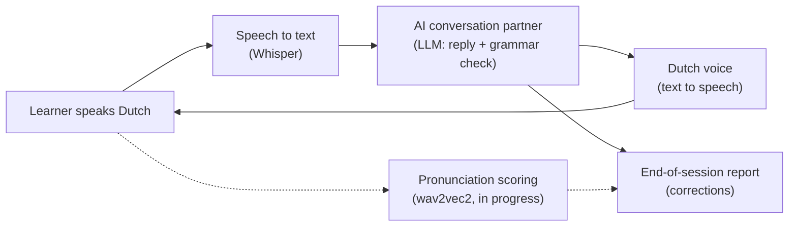

# Dutch Speaking Practice App

**An AI conversation partner that helps newcomers in the Netherlands practise speaking Dutch, with feedback on grammar and pronunciation.**

Work in progress · TechPros Rotterdam, Deep Learning (AI) track, Cohort 8 · Final demo: 7 December 2026

---

## The problem

Many internationals in the Netherlands struggle to practise *speaking* Dutch:

- Native speakers often switch to English as soon as they hear an accent.
- Language classes are large, so each student gets only a few minutes of speaking time.
- Fear of making mistakes keeps people quiet, which slows down integration, job chances and exam success.

Reading and grammar apps are everywhere. A safe place to actually **talk** is not.

## The solution

A voice app where the learner has a realistic spoken conversation in Dutch, such as calling the GP (huisarts) to book an appointment. The AI partner:

- **listens** to what the learner says,
- **replies out loud** in simple Dutch at the learner's level, staying in role,
- **never switches to English**,
- quietly **notes grammar mistakes** and shows them in a report at the end, so the conversation is never interrupted,
- (in progress) **scores pronunciation** of difficult Dutch sounds such as *g*, *ui*, *eu*, *ij* and *uu*.

## Who benefits

- **Expats, newcomers and internationals** living in the Netherlands
- People preparing for **inburgering** or **staatsexamen** speaking tests
- **International job seekers** who need Dutch at work

## Why I am building this

I moved to the Netherlands and am learning Dutch myself. I know how hard it is to find a safe space to practise speaking. This is the tool I wish I had, and it gives me hands-on experience with speech recognition, large language models and deep learning.

---

## How it works



One conversation turn, in plain words:

1. The AI receptionist greets the learner with a Dutch voice.
2. The learner presses a key and answers out loud.
3. **Speech to text:** the recording is turned into text. Silence is removed first, and the model gets a hint about which words to expect in this scenario.
4. **Conversation partner:** a language model replies in role, in simple Dutch, and separately lists any grammar mistakes in a structured format.
5. **Voice:** the reply is spoken with a natural Dutch voice, and the next turn begins.
6. **Report:** when the conversation ends, the learner sees every mistake with the correct form and a short explanation.

### Example

*Conversation (spoken):*

> **Assistant:** Huisartsenpraktijk De Linde, goedemorgen. Waarmee kan ik u helpen?
> **Learner:** Ik heb koorts sinds twee dagen.
> **Assistant:** Dat is vervelend. Heeft u ook andere klachten?
> **Learner:** Nee, ik heb niet andere klachten.
> **Assistant:** Is het goed als u vandaag om twee uur komt?

*Session report:*

> **You said:** niet andere
> **Correct:** geen andere
> **Why:** Use 'geen' instead of 'niet' when negating a noun.

---

## Key design decisions

| Decision | Why |
|---|---|
| **Feedback after the conversation, not during it** | Constant interruptions make learners nervous. The partner repeats the correct form naturally instead, like a patient native speaker would. |
| **"The AI labels, the code decides"** | The language model labels each correction (grammar, word choice, English word, spelling). Simple Python rules then remove spelling and spacing issues, which usually come from speech recognition rather than the learner. Code follows rules reliably; a language model does not always. |
| **Two separate "ears"** | Whisper is good at understanding what the learner *meant*, so it can silently "fix" mispronunciations. A separate deep learning model (wav2vec2) is needed to hear what was actually *said*. |
| **Choices based on measurements** | Model settings were chosen by testing speed and accuracy on real recordings, not by guessing (see Results). |
| **Privacy by design** | See Privacy section below. |

---

## Results so far

### Speech recognition: speed vs accuracy

Four Whisper settings were tested on the same Dutch recordings by a non-native speaker. WER (word error rate) is the share of words transcribed incorrectly.

| Model | Beam size | WER | Avg time per sentence |
|---|---|---|---|
| small | 5 | 16.3% | 7.0 s |
| small | 1 | 20.4% | 6.2 s |
| **base** | **5** | **16.3%** | **2.0 s** |
| base | 1 | 32.7% | 1.8 s |

**Chosen:** base model, beam size 5: the same accuracy as the larger model on this test set, 3.5 times faster on a laptop CPU. *Caveat: only 5 test sentences; to be confirmed with more speakers.*

### Improvements in the live voice loop

| Change | Effect |
|---|---|
| Silence filter (voice activity detection) | Average transcription time 4.1 s → 2.8 s; no more invented text from silence or keyboard noise |
| Scenario word hint for Whisper | Key words like *koorts* (fever) recognised correctly instead of *kort* (short) |
| Correction labels + filter | Report shows only real language mistakes |

### Response time per turn

The learner waits about **6 seconds** between finishing speaking and hearing the reply: roughly 2 to 3 s speech recognition, 1 to 2 s language model, 2 s voice generation. The original target was under 3 seconds; reducing this further is on the roadmap.

---

## Privacy and responsible AI

- **Voice recordings are never stored** in the live app: audio stays in memory and is discarded after transcription.
- **Test recordings stay local:** the `data/` folder is excluded from GitHub.
- **No personal data requested:** the AI partner is instructed never to ask for a date of birth, address or BSN.
- **API keys are kept out of the code** in a local `.env` file that is never uploaded.
- **Known limitation:** the current Dutch voice uses an unofficial free service, suitable for a prototype. A real product would use the official, paid Azure text-to-speech service (same voices).

---

## Tech stack

| Part | Tool |
|---|---|
| Speech to text | Whisper (base model) via `faster-whisper`, running locally |
| Conversation partner | Gemini 3.1 Flash Lite via the Runware API, with structured JSON output |
| Text to speech | Microsoft Dutch neural voice (Fenna) via `edge-tts` |
| Pronunciation scoring | wav2vec2 fine-tuned on Dutch phonemes (in progress) |
| Evaluation | `jiwer` for word error rate |
| Audio in/out | `sounddevice` |
| Language | Python 3.12 |

---

## Project structure

```
dutch-speaking-app/
├── README.md              This page
├── scenarios.md           The practice situations (GP, municipality, job interview) at A2 level
├── requirements.txt       Python libraries the project needs
├── data/                  Test recordings (local only, never uploaded)
├── notebooks/             Experiments (coming)
└── src/
    ├── voice_chat.py      ★ The full app: speak, transcribe, reply, voice, report
    ├── chat_feedback.py   Typed version with grammar feedback; holds the AI partner's instructions
    ├── speak.py           Turns Dutch text into speech and plays it
    ├── chat.py            First simple typed conversation (no feedback)
    ├── evaluate_wer.py    Measures speech recognition accuracy
    ├── speed_test.py      Compares Whisper settings on speed and accuracy
    ├── transcribe.py      First speech-to-text test
    ├── test_mic.py        Microphone recording test
    ├── test_llm.py        First language model test
    └── test_tts.py        Compares three Dutch voices
```

---

## Roadmap

- [x] Speech to text with Whisper, accuracy measured (WER)
- [x] AI conversation partner with memory, staying in role
- [x] Grammar feedback in structured format, with end-of-session report
- [x] Dutch voice output
- [x] Full spoken conversation loop
- [x] Speed improvements: smaller model, silence filter, scenario hints
- [ ] Pronunciation scoring for difficult Dutch sounds (wav2vec2)
- [ ] Simple web interface
- [ ] Testing with real learners
- [ ] More scenarios and levels

---

## Run it yourself

Requires Python 3.11+, a microphone, and a Runware API key.

```bash
git clone https://github.com/ankitasinhadu-ctrl/dutch-speaking-app.git
cd dutch-speaking-app
python -m venv .venv
source .venv/Scripts/activate      # Windows (Git Bash); on Mac/Linux: source .venv/bin/activate
pip install -r requirements.txt
echo "RUNWARE_API_KEY=your_key_here" > .env
python src/voice_chat.py
```

---

## About

Built by **Ankita Sinha** as part of the TechPros Rotterdam Deep Learning (AI) program.
AI speaking partner for practising Dutch, with grammar and pronunciation feedback.
Topics : speech-recognition, whisper, llm, language-learning, dutch, python.

[LinkedIn](https://linkedin.com/in/ankita-sinha-586a5118) · [GitHub](https://github.com/ankitasinhadu-ctrl)
